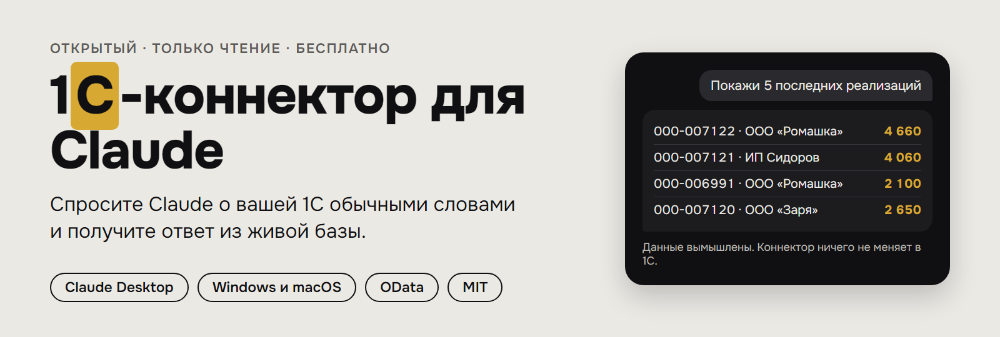
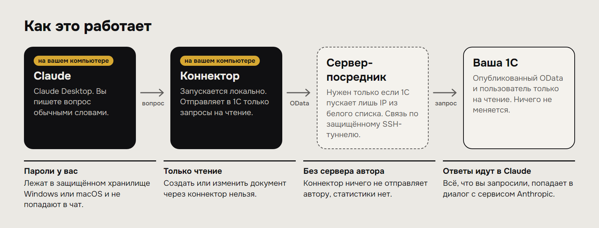
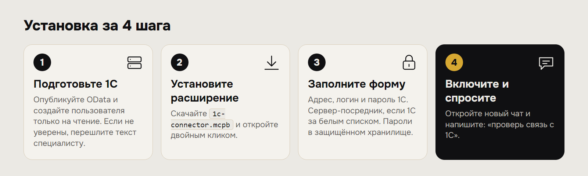
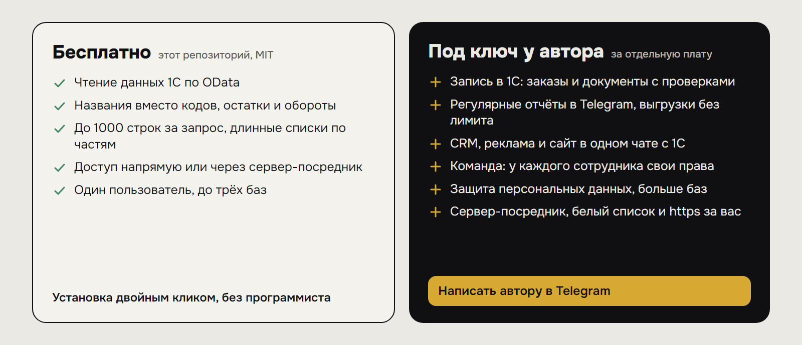

<p align="center">
  <a href="https://github.com/glxaoc/1c-claude-connector/releases/latest"></a>
</p>

<p align="center">
  <a href="https://github.com/glxaoc/1c-claude-connector/releases/latest"></a>
  <a href="LICENSE"></a>
  
  
</p>

<p align="center">
  <a href="https://github.com/glxaoc/1c-claude-connector/releases/latest/download/1c-connector.mcpb"></a>
  <a href="https://t.me/Ioann_d?text=%D0%97%D0%B4%D1%80%D0%B0%D0%B2%D1%81%D1%82%D0%B2%D1%83%D0%B9%D1%82%D0%B5%21%20%D0%9D%D0%B0%D1%88%D1%91%D0%BB%20%D0%BA%D0%BE%D0%BD%D0%BD%D0%B5%D0%BA%D1%82%D0%BE%D1%80%201%D0%A1%20%D0%B4%D0%BB%D1%8F%20Claude%20%D0%BD%D0%B0%20GitHub%2C%20%D1%85%D0%BE%D1%87%D1%83%20%D0%BF%D0%BE%D0%B4%D0%BA%D0%BB%D1%8E%D1%87%D0%B8%D1%82%D1%8C%20%D1%81%D0%B2%D0%BE%D1%8E%201%D0%A1.%20%5Bgh-claude-hero%5D"></a>
</p>

<p align="center">
  <b><a href="#как-это-выглядит">Как это выглядит</a></b> ·
  <b><a href="#как-это-работает">Как работает</a></b> ·
  <b><a href="#установка-за-4-шага">Установка за 4 шага</a></b> ·
  <b><a href="#что-можно-спросить">Что можно спросить</a></b> ·
  <b><a href="#бесплатно-и-под-ключ">Бесплатно и под ключ</a></b> ·
  <b><a href="#частые-проблемы">Частые проблемы</a></b>
</p>

**Спросите Claude о вашей 1С обычными словами и получите ответ из живой базы.** Продажи, остатки, номенклатура, контрагенты: без выгрузок в Excel и без программиста на каждый вопрос.

Коннектор работает только на чтение: он не может ничего изменить или удалить в 1С. Для Claude Desktop на Windows и macOS. Установка двойным кликом по файлу `.mcpb`.

## Как это выглядит

> **Вы:** Покажи 5 последних реализаций с названием контрагента и суммой.
>
> **Claude:**
>
> | Номер | Дата | Контрагент | Сумма |
> | --- | --- | --- | ---: |
> | 000-007122 | 04.10.2026 | ООО «Ромашка» | 4 660 |
> | 000-007121 | 03.10.2026 | ИП Сидоров | 4 060 |
> | 000-006991 | 03.10.2026 | ООО «Ромашка» | 2 100 |
> | 000-007120 | 02.10.2026 | ООО «Заря» | 2 650 |
> | 000-007119 | 02.10.2026 | ООО «Вектор» | 8 520 |

Данные в примере вымышленные. Вы пишете вопрос, Claude сам находит нужные объекты в базе, строит запрос и показывает результат.

## Что умеет

- Отвечает по любым данным, которые опубликованы через OData: справочники, документы, регистры накопления и сведений.
- Считает остатки на складах и обороты за период, достаёт последние значения цен.
- Показывает названия вместо внутренних кодов 1С: контрагент, номенклатура, склад.
- Подключается напрямую с вашего компьютера или через сервер-посредник, если 1С пускает только IP из белого списка.
- Работает с несколькими базами сразу (до трёх), например «Бухгалтерия» и «ERP».
- Проверяет связь пошагово и простым языком объясняет, что не так и что исправить.

## Как это работает



- Коннектор запускается **на вашем компьютере**, отдельного сервера у него нет и ничего не отправляется автору.
- В 1С уходят только запросы на чтение, пользователь 1С должен быть только на чтение.
- Если 1С пускает только IP из белого списка, коннектор ходит в неё через ваш сервер по защищённому SSH-туннелю.
- Всё, что вы запросили, попадает в диалог с Claude (сервис Anthropic). Помните об этом, если в базе есть персональные данные.

## Установка за 4 шага



## Бесплатно и под ключ

<a href="https://t.me/Ioann_d?text=%D0%97%D0%B4%D1%80%D0%B0%D0%B2%D1%81%D1%82%D0%B2%D1%83%D0%B9%D1%82%D0%B5%21%20%D0%A3%D0%B2%D0%B8%D0%B4%D0%B5%D0%BB%20%D0%BD%D0%B0%20GitHub%20%D1%83%D1%81%D0%BB%D1%83%D0%B3%D0%B8%20%C2%AB%D0%BF%D0%BE%D0%B4%20%D0%BA%D0%BB%D1%8E%D1%87%C2%BB%2C%20%D1%85%D0%BE%D1%87%D1%83%20%D0%BE%D0%B1%D1%81%D1%83%D0%B4%D0%B8%D1%82%D1%8C%20%D0%B2%D0%BD%D0%B5%D0%B4%D1%80%D0%B5%D0%BD%D0%B8%D0%B5%20%D0%98%D0%98%20%D0%B2%20%D0%BC%D0%BE%D0%B5%D0%B9%20%D0%BA%D0%BE%D0%BC%D0%BF%D0%B0%D0%BD%D0%B8%D0%B8.%20%5Bgh-claude-offer-img%5D"></a>

Коннектор бесплатный, открытый (MIT) и ставится самостоятельно. Что в нём есть и что автор делает отдельно:

| Бесплатная версия (этот репозиторий) | Под ключ у автора |
| --- | --- |
| Чтение данных 1С по OData | Запись в 1С: создание заказов и документов с проверками |
| До 1000 строк за запрос, длинные списки по частям | Выгрузки без ограничений, регулярные отчёты в Telegram |
| Один пользователь, до трёх баз | Работа для команды: у каждого сотрудника свои права, журнал обращений |
| Только данные 1С | CRM, реклама и сайт (Bitrix24, Twenty, Метрика, Директ) в одном чате с 1С |
| Данные запроса попадают в диалог с ИИ-сервисом | Защищённый шлюз: персональные данные не уходят в нейросеть |
| Самостоятельная настройка доступа | Настройка сервера-посредника, белого списка IP и https за вас |

<p align="center">
  <a href="https://t.me/Ioann_d?text=%D0%97%D0%B4%D1%80%D0%B0%D0%B2%D1%81%D1%82%D0%B2%D1%83%D0%B9%D1%82%D0%B5%21%20%D0%9F%D0%B8%D1%88%D1%83%20%D0%B8%D0%B7%20%D1%80%D0%B5%D0%BF%D0%BE%D0%B7%D0%B8%D1%82%D0%BE%D1%80%D0%B8%D1%8F%201%D0%A1-%D0%BA%D0%BE%D0%BD%D0%BD%D0%B5%D0%BA%D1%82%D0%BE%D1%80%D0%B0%20%D0%B4%D0%BB%D1%8F%20Claude%2C%20%D0%B5%D1%81%D1%82%D1%8C%20%D0%B2%D0%BE%D0%BF%D1%80%D0%BE%D1%81.%20%5Bgh-claude-footer%5D"></a>
  <a href="https://t.me/+3N-D00524gcyMWEy"></a>
</p>

Консультация: разберём ваш бизнес, какие данные подключить к нейросети, что это даст и какие у этого ограничения.

## Чего не делает

- **Не записывает ничего в 1С.** Коннектор отправляет только запросы на чтение. Создать, изменить или удалить документ через него невозможно.
- **Не обходит права доступа.** Claude видит только то, что открыто пользователю, под которым вы подключились.

## Подробно по шагам

**Что понадобится:** Claude Desktop, база 1С с опубликованным OData и пользователь 1С с правами только на чтение.

**1. Подготовьте 1С.** Если вы не уверены, что OData включён, перешлите тому, кто обслуживает вашу 1С:

> Опубликуйте базу через OData, настройте состав: номенклатура, контрагенты, цены, остатки, продажи. Создайте пользователя только на чтение и пришлите адрес, логин и пароль.

Адрес выглядит так: `http://адрес-сервера/имя-базы/odata/standard.odata/`. Окончание можно не писать, коннектор допишет его сам. Подробности публикации: [настройка OData](https://github.com/evilbruce666/1c-odata-mcp/blob/main/docs/ODATA-SETUP.md).

**2. Установите коннектор.** Скачайте [1c-connector.mcpb](https://github.com/glxaoc/1c-claude-connector/releases/latest/download/1c-connector.mcpb) и откройте файл двойным кликом. Если Windows спросит, чем открыть, выберите Claude.

**3. Заполните форму.**

| Поле | Что вписать |
| --- | --- |
| Адрес OData | Адрес от тех. специалиста |
| Логин 1С и пароль 1С | Пользователь только на чтение |
| Описание базы | Необязательно. Одна фраза для Claude, например «УТ 11, оптовая торговля, склады Москва и Калининград» |

Остальные поля оставьте пустыми, если 1С открыта для вашего компьютера и база у вас одна.

**4. Проверьте.** Включите расширение, откройте новый чат и напишите: **«проверь связь с 1С»**. Claude покажет шаги проверки с галочками и предложит первые вопросы.

> После изменения настроек выключите и снова включите расширение: настройки читаются при запуске.

## Несколько баз сразу

Можно подключить до трёх баз одновременно, например «Бухгалтерию» и «ERP». В форме у каждой своё название, адрес, логин и пароль, все пароли лежат в защищённом хранилище системы.

| Поле | Что вписать |
| --- | --- |
| Название базы | Короткое имя первой базы, например «Бухгалтерия» |
| Вторая база: название, адрес, логин, пароль | Например «ERP» и её доступы |
| Третья база | Так же, по желанию |

Дальше Claude выбирает базу по названию из вашего вопроса: «покажи реализации из ERP», «сравни остатки в Бухгалтерии и в ERP». Если из вопроса неясно, о какой базе речь, он уточнит. Сервер-посредник (если нужен) один на все базы. Проверка связи показывает каждую базу отдельно, и если одна не отвечает, остальные работают.

## Если 1С закрыта белым списком IP

Это частая ситуация: 1С пускает только заранее известные адреса, и с домашнего компьютера она не откроется. Решение: сервер в интернете, чей IP добавлен в белый список. Коннектор открывает защищённый SSH-туннель к этому серверу и ходит в 1С с его адреса. **Ничего устанавливать на сервер не нужно**, достаточно обычного SSH-доступа.

Дополнительно заполните в форме:

| Поле | Что вписать |
| --- | --- |
| Сервер-посредник | IP сервера, например `203.0.113.10`. Если порт SSH не 22: `203.0.113.10:2222` |
| Логин сервера (SSH) | Пользователь для туннеля |
| Пароль сервера (SSH) | Его пароль. Если сервер пускает только по ключу, оставьте пустым |
| Файл SSH-ключа | Приватный ключ, если вход по ключу |

Если вход не удался, проверка связи покажет, какие способы входа разрешает сервер (пароль, ключ или оба), и подскажет причину. Настроить сервер-посредник, белый список и https за вас может автор: [написать](https://t.me/Ioann_d?text=%D0%97%D0%B4%D1%80%D0%B0%D0%B2%D1%81%D1%82%D0%B2%D1%83%D0%B9%D1%82%D0%B5%21%20%D0%A3%20%D0%BC%D0%B5%D0%BD%D1%8F%201%D0%A1%20%D0%B7%D0%B0%D0%BA%D1%80%D1%8B%D1%82%D0%B0%20%D0%B1%D0%B5%D0%BB%D1%8B%D0%BC%20%D1%81%D0%BF%D0%B8%D1%81%D0%BA%D0%BE%D0%BC%20IP%2C%20%D0%BD%D1%83%D0%B6%D0%BD%D0%B0%20%D0%BF%D0%BE%D0%BC%D0%BE%D1%89%D1%8C%20%D1%81%20%D1%81%D0%B5%D1%80%D0%B2%D0%B5%D1%80%D0%BE%D0%BC-%D0%BF%D0%BE%D1%81%D1%80%D0%B5%D0%B4%D0%BD%D0%B8%D0%BA%D0%BE%D0%BC.%20%5Bgh-claude-whitelist%5D).

### Рекомендуемая настройка сервера

Не используйте root. Заведите отдельного пользователя только для туннеля: без командной строки и с пересылкой на один адрес. Замените `203.0.113.50:80` на адрес и порт вашей 1С.

```bash
adduser --shell /usr/sbin/nologin --gecos "" --disabled-password tunnel1c
passwd tunnel1c
```

```bash
cat > /etc/ssh/sshd_config.d/99-1c-tunnel.conf <<'EOF'
Match User tunnel1c
    PasswordAuthentication yes
    AllowTcpForwarding yes
    PermitOpen 203.0.113.50:80
    PermitTTY no
    X11Forwarding no
    ForceCommand /usr/sbin/nologin
EOF
sshd -t && systemctl reload ssh
```

Задайте длинный пароль, от 16 символов. Отпечаток ключа сервера запоминается при первом подключении (`~/.1c-connector/known_hosts.json`). Если он изменится, коннектор откажется подключаться и предупредит об этом.

## Что можно спросить

**Продажи**
- Покажи 5 последних реализаций с названием контрагента
- Сколько мы продали за сентябрь и кто купил больше всех
- Какие контрагенты не покупали больше трёх месяцев

**Склад**
- Какие остатки по складам, покажи названия товаров
- Что заканчивается на складе
- Сколько позиций в номенклатуре

**Справочники**
- Найди контрагента по ИНН
- Какие цены у позиции с названием «...»

**Разбор базы**
- Какие объекты 1С тебе доступны
- Какие поля есть у документа «Реализация товаров и услуг»

**Что ещё можно подключить**
- Что ещё можно подключить к этому чату (коннектор покажет список и поможет составить сообщение автору)

Названия объектов зависят от конфигурации. Claude находит нужные сам, ничего запоминать не нужно.

## Безопасность и данные

- **Только чтение.** Коннектор использует исключительно GET-запросы. Дополнительно ограничьте права пользователя в самой 1С.
- **Пароли не попадают в чат.** Их вы вводите в форме расширения, они хранятся в Windows Credential Manager или macOS Keychain.
- **Шифрование.** Если OData опубликован по `http://`, логин и пароль 1С идут по сети открыто. Для постоянной работы попросите тех. специалиста настроить https.
- **Данные попадают в диалог с Claude** и обрабатываются сервисом Anthropic, серверы которого находятся за пределами вашей компании. Если в базе есть персональные данные физических лиц, у оператора есть обязанности по 152-ФЗ. Начинайте с остатков, номенклатуры и сумм без персональных данных. Коннектор предупреждает, когда в ответе есть поля вроде телефона или ФИО.
- **Подсказки автора.** В ответах коннектора иногда есть пометка «Справка от автора»: когда задача выходит за пределы бесплатной версии или когда вы сами спросили, что ещё можно подключить. Они не меняют ответ, не чаще нескольких раз за запуск и подписаны. Коннектор ничего не отправляет автору сам: никакой статистики и проверок обновлений через интернет нет, сообщение автору уходит только если вы сами откроете ссылку.
- **Размер ответа.** За один запрос приходит до 1000 строк и не больше примерно 150 КБ текста, больше в диалог не помещается. Длинные списки коннектор читает из 1С порциями сам, а для итогов Claude использует подсчёт и обороты, а не выгрузку тысяч строк. Если нужна полная выгрузка, просите по частям (по периоду или по группе) или только нужные поля.

## Частые проблемы

| Что происходит | Что делать |
| --- | --- |
| Windows спрашивает, чем открыть `.mcpb` | Выберите Claude |
| Поменяли настройки, ничего не изменилось | Выключите и снова включите расширение |
| Таймаут, 502, «не отвечает» | Скорее всего, IP не в белом списке 1С: нужен сервер-посредник. Отключите VPN и прокси на время проверки |
| 401, «отклонила логин или пароль» | Проверьте логин и пароль 1С. Если логин на кириллице, попросите пользователя с латинским именем |
| 404, «нет OData» | Проверьте адрес и имя базы, возможно OData не опубликован на веб-сервере |
| Сервер не принял логин или пароль SSH | Проверка связи покажет разрешённые способы входа и причину |
| Сервер пускает только по ключу | Выберите файл приватного ключа в поле SSH-ключа |
| Сервер запрещает пересылку | Администратору нужно включить `AllowTcpForwarding yes` |
| Самоподписанный сертификат https | Включите «Разрешить самоподписанный сертификат» |
| В ответе коды вместо названий | Напишите Claude: «покажи названия вместо кодов» |

Не помогло? Откройте [issue](https://github.com/glxaoc/1c-claude-connector/issues/new/choose) и приложите вывод проверки связи (в нём нет паролей).

## Совместимость

Проверено на «Управлении торговлей 11» с Claude Desktop на Windows. Другие конфигурации (ERP, «Бухгалтерия», «Комплексная автоматизация», «ЗУП») должны работать, потому что коннектор не привязан к именам объектов и ищет их по базе, но на реальных установках они пока не тестировались. macOS поддерживается, на реальном Mac пока не проверялся. Если встретите проблему, [откройте issue](https://github.com/glxaoc/1c-claude-connector/issues/new/choose).

<details>
<summary><b>Для разработчиков</b></summary>

&nbsp;

Локальный MCP-сервер на Node.js, упакованный в [MCPB](https://github.com/modelcontextprotocol/mcpb). Инструменты: `check_connection`, `list_objects`, `describe_object`, `query`, `count`, `what_else`, `contact_author`.

```bash
npm install
npm test        # сценарии на имитации 1С и SSH-сервера
npm run pack    # чистит нативные модули, валидирует, собирает dist/1c-connector.mcpb
```

Собирать пакет нужно только через `npm run pack`: он удаляет собранные под одну ОС нативные модули ssh2, чтобы расширение работало и на Windows, и на macOS. В `.mcpbignore` шаблоны указываются от корня (`/dist/`, `/tests/`), иначе из пакета выпадают одноимённые папки внутри `node_modules`.

Перед новой версией: поднимите `VERSION` в `server/index.js` и `version` в `manifest.json`, `package.json`, `package-lock.json`, прогоните тесты, соберите и распакуйте `.mcpb` (`npx @anthropic-ai/mcpb unpack`), проверив, что внутри есть `node_modules/@modelcontextprotocol/sdk/dist/esm/server/mcp.js`. Файлы настроек и пароли в репозиторий не добавляйте: `settings.xml`, `.env`, `work/` в `.gitignore`.

</details>

## English

**1C Connector for Claude** is a Claude Desktop extension (MCPB) that lets Claude read data from 1C:Enterprise through its standard OData interface. Read-only (GET requests only). Works directly or through an SSH jump host for 1C installations restricted by an IP allowlist. Credentials are stored in the OS keychain. Free and open source (MIT). Download the latest `.mcpb` from [Releases](https://github.com/glxaoc/1c-claude-connector/releases/latest). Custom integrations (writing to 1C, CRM, reports, team access) are available from the author.

## Автор и лицензия

Иван Дробитько, внедрение нейросетей в бизнес. Консультация и внедрение под ключ: [написать в Telegram](https://t.me/Ioann_d?text=%D0%97%D0%B4%D1%80%D0%B0%D0%B2%D1%81%D1%82%D0%B2%D1%83%D0%B9%D1%82%D0%B5%21%20%D0%9F%D0%B8%D1%88%D1%83%20%D0%B8%D0%B7%20README%201%D0%A1-%D0%BA%D0%BE%D0%BD%D0%BD%D0%B5%D0%BA%D1%82%D0%BE%D1%80%D0%B0%20%D0%B4%D0%BB%D1%8F%20Claude%2C%20%D1%85%D0%BE%D1%87%D1%83%20%D0%BA%D0%BE%D0%BD%D1%81%D1%83%D0%BB%D1%8C%D1%82%D0%B0%D1%86%D0%B8%D1%8E.%20%5Bgh-claude-readme-end%5D). Кейсы и новости коннектора: [Telegram-канал](https://t.me/+3N-D00524gcyMWEy). Лицензия MIT.
